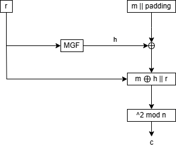
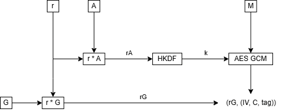

# CRY Labo 3

## 1. "Encryption"

### 1.1. Schéma de l'algorithme



### 1.2. Description mathématique

**Chiffrement :**

1. On ajoute le padding au message `m` pour obtenir `m || padding`
2. On applique la fonction `MGF` sur un `r` généré aléatoirement pour obtenir `h`
3. On xor `h` avec `m || padding`
4. On concatène `r` avec le résultat du xor
5. On met le tout au carré modulo `n` pour obtenir `c`

**Déchiffrement :**

1. On trouve la racine carrée de `c` à l'aide du théorème des restes chinois
2. On déconcatène `r` de la racine carée
3. On applique la fonction `MGF` sur `r` pour obtenir `h`
4. On xor la racine carrée avec `h` pour obtenir `m || padding`
5. On enlève le padding pour obtenir `m`

### 1.3. Implémentation du déchiffrement

La fonction de déchiffrement est implémentée sous le nom de `decrypt`. Elle a été testée dans la fonction `test_decryption` avec des messages différents pour chaque test :

```
-----Test 1-----
Original message : Hello, this is a test message for encryption.
Decrypted message: Hello, this is a test message for encryption.
-----Test 2-----
Original message : Another test message for encryption.
Decrypted message: Another test message for encryption.
-----Test 3-----
Original message : Short message for encryption.
Decrypted message: Short message for encryption.
```

### 1.4. Récupération du message

Etant donné que je connais les quatre racines, je peux choisir deux racines distinctes et calculer $\gcd(r1 - r2, n)$. Si le résultat est égal à 1, ce sont deux racines congrues ou oppposées modulo `n`, ce n'est pas intéressant. Par contre, si le PGCD est différent de 1, cela signifie que j'ai trouvé `p`. Ainsi, je peux trouver `q` en utilisant la formule $q=n/p$ et je peux déchiffrer le message.

- Message : `Ni! Ni! Ni! We want a borderline`

### 1.5. Problème difficile

Cette construction est basée sur le problème de la factorisation.

### 1.6. Redondance dans la construction

Elle agit comme un contrôle d'intégrité. Si le texte chiffré est modifié, le padding ne sera pas valide et le déchiffrement échouera. Ainsi, elle empêche les attaques par texte chiffré choisi.

## 2. Courbes Elliptiques

### 2.1. Schéma de l'algorithme



### 2.2. Description mathématique

**Chiffrement :**

1. On génère un entier aléatoire $r \in [0, n-1]$
2. On multiplie la clé publique `A` par `r` : $rA = r \cdot A$
3. On dérive une clé symétrique `k` à partir du point `rA` : $k = HKDF(rA)$
4. On chiffre le message `M` avec AES GCM en utilisant la clé `k`.
5. On multiplie `r` par le point `G` : $rG = r \cdot G$
6. Le résultat du chiffrement est le couple `(rG, (IV, C, tag))`

**Déchiffrement :**

1. On calcule le point `rA` en multipliant la clé privée `a` par le point `rG` : $rA = a \cdot rG$
2. On dérive la clé symétrique `k` à partir du point `rA` : $k = HKDF(rA)$
3. On déchiffre le texte chiffré `C` avec AES GCM en utilisant la clé `k`.

### 2.3. Implémentation du déchiffrement

La fonction de déchiffrement est implémentée sous le nom de `decrypt`. Elle a été testée dans la fonction `test_decryption` avec des messages différents pour chaque test :

```
-----Test 1-----
Original message : Hello, this is a test message for elliptic.
Decrypted message: Hello, this is a test message for elliptic.
-----Test 2-----
Original message : Another test message for elliptic.
Decrypted message: Another test message for elliptic.
-----Test 3-----
Original message : Short message for elliptic.
Decrypted message: Short message for elliptic.
```

### 2.4. Problème de l'algorithme

La courbe elliptique a un ordre `n` trop petit (42 bits), ce qui rend le problème du logarithme discret facile à résoudre.

### 2.5. Récupération du message

Etant donné l'ordre trop petit de la courbe elliptique, je peux retrouver la valeur aléatoire `r` en calculant simplement $r = \log_{G}(rG)$. Ensuite, je peux retrouver `rA` en calculant $rA = r \cdot A$ et dériver la clé symétrique pour déchiffrer le message.

- Message : `Nobody expects the spanish inquisition ! Our chief weapon is jutted`

### 2.6. Correction de l'erreur dans la construction

Comme vu dans le cours, il faut utiliser des courbes elliptiques proposées dans des standards. J'ai donc utilisé la courbe `P-256` pour obtenir un ordre `n` de 256 bits.

## 3. RSA

### 3.1. Implémentation du déchiffrement

La fonction de déchiffrement est implémentée sous le nom de `decrypt`. Elle a été testée dans la fonction `test_decryption` avec des messages différents pour chaque test :

```
-----Test 1-----
Original message : Hello, this is a test message for RSA.
Decrypted message: Hello, this is a test message for RSA.
-----Test 2-----
Original message : Another test message for RSA.
Decrypted message: Another test message for RSA.
-----Test 3-----
Original message : Short message for RSA.
Decrypted message: Short message for RSA.
```

### 3.2. Récupération du message

Dans la fonction `keygen`, on peut voir que les nombres `p` et `q` sont trop proches, ce qui me permet de les retrouver en factorisant `n` avec la méthode de Fermat. Cette méthode consiste à exprimer `n` comme une différence de deux carrés $n = x^2 - y^2$, ce qui peut être factorisé comme $(x-y)(x+y)$. Le fonctionnement de la méthode est le suivant :

1. On initialise `a` à $\lfloor \sqrt{n} \rfloor + 1$ (le plus petit entier supérieur à $\sqrt{n}$)
2. On calcule $b^2 = a^2 - n$
3. On vérifie si `b` est un entier, si oui, les deux facteurs sont $p = a - b$ et $q = a + b$. Sinon, on incrémente `a` et on recommence jusqu'à trouver un `b` entier.

Une fois que j'ai trouvé `p` et `q`, je peux calculer $d = e^{-1} \mod \varphi((p-1)(q-1))$ et donc déchiffrer le message.

- Message : `What is your quest? To seek the holy grail. What is your favorite color? splurges`
